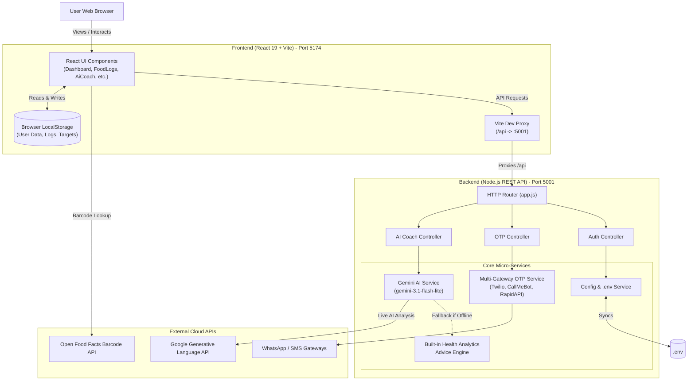

# FitLife Architecture & System Design

This document details the architectural layout, component interactions, and data flow of the FitLife platform.

---

## 🏗️ High-Level System Architecture



---

## 📁 Clean Directory Hierarchy

```
FitLife/
├── backend/                      # Node.js API server & microservices
│   ├── src/
│   │   ├── controllers/          # Request endpoints handlers
│   │   │   ├── aiCoachController.js
│   │   │   ├── authController.js
│   │   │   └── otpController.js
│   │   ├── services/             # Core business logic & integrations
│   │   │   ├── configService.js  # .env configuration reader & updater
│   │   │   ├── geminiService.js  # Google Gemini 3.1 Flash API integration
│   │   │   ├── healthAdviceService.js # Built-in rules engine fallback
│   │   │   └── otpService.js     # WhatsApp/SMS dispatchers
│   │   └── app.js                # HTTP Request router & middleware
│   ├── package.json              # Backend package definition
│   └── server.js                 # API server entry point (Port 5001)
│
├── frontend/                     # React 19 Client Application
│   ├── public/                   # Favicons and SVG sprite assets
│   ├── src/
│   │   ├── assets/               # Images, logos, and graphics
│   │   ├── components/           # UI components with scoped CSS
│   │   ├── data/                 # Indian food library & exercise databases
│   │   ├── types/                # TypeScript interface definitions
│   │   ├── utils/                # Database and Firebase utility wrappers
│   │   ├── admin.jsx             # Admin dashboard entry point
│   │   ├── App.jsx               # Main React dashboard application
│   │   ├── index.css             # Design system & theme CSS variables
│   │   └── main.jsx              # Frontend bootstrapper
│   ├── admin.html                # Admin console HTML shell
│   ├── index.html                # Main application HTML shell
│   ├── package.json              # Frontend dependencies and scripts
│   ├── tsconfig.json             # TypeScript compiler settings
│   └── vite.config.js            # Vite configuration with API proxying
│
├── documentation/                # Central project documentation
│   ├── ARCHITECTURE.md           # Architecture and system design (this file)
│   ├── API_DOCUMENTATION.md      # REST API endpoints reference
│   ├── SETUP_GUIDE.md            # Installation & environment setup guide
│   └── FEATURES_OVERVIEW.md      # Detailed walkthrough of platform features
│
├── scripts/                      # Automation & developer scripts
│   └── start-dev.js              # Concurrent full-stack dev server launcher
│
├── .env                          # Local environment secret variables
├── .env.example                  # Environment template
├── .gitignore                    # Git tracking ignore rules
├── package.json                  # Root monorepo workspace configuration
└── README.md                     # Project overview and quick start
```

---

## ⚡ Data Flow Highlights

1. **State Persistence**: User profile, meal logs, water intake, workouts, and sleep records persist instantaneously in `localStorage` under isolated keys, ensuring zero latency and privacy.
2. **AI Health Coach**:
   - The React UI posts daily aggregated metrics (calories, protein, carbs, fat, water, sleep, exercise) to `/api/ai-coach`.
   - The Vite development proxy forwards the request to the Node.js backend on `http://localhost:5001`.
   - The backend checks for `GEMINI_API_KEY`. When available, it queries Google Gemini using current models (`gemini-3.1-flash-lite`).
   - If offline or missing a key, it seamlessly invokes the built-in health advice heuristics engine.

